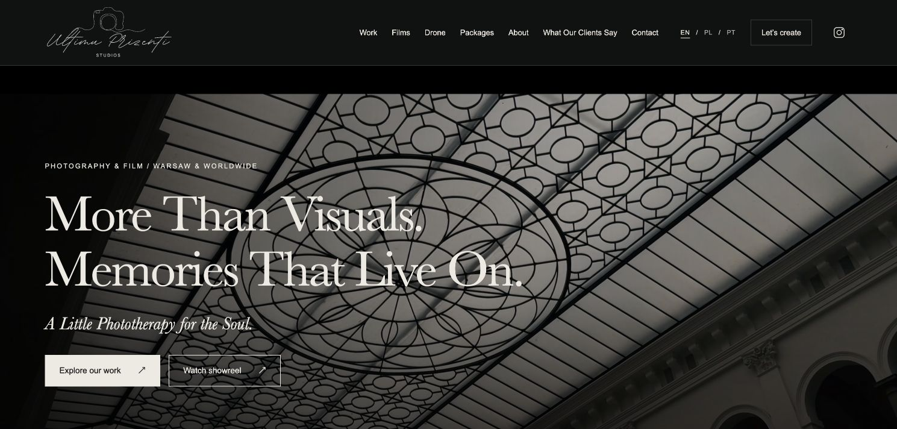
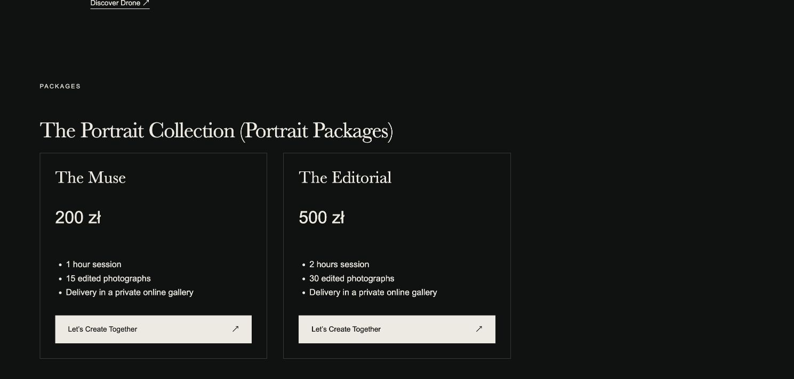

# Ultimu Prizenti Studios

A multilingual photography and filmmaking website I developed for my own company,
**Ultimu Prizenti Studios**, based in Warsaw and available for projects worldwide.

This project brings together my creative work and my interest in information
technology: brand identity, visual direction, photography, filmmaking and a complete
web experience. I created the brand identity, website design and original photographic and audiovisual
portfolio, and developed this project for my business. I am sharing the project to demonstrate my technical
skills, product decisions and ability to take a real business requirement through
to a working website.

> More Than Visuals. Memories That Live On.
>
> A Little Phototherapy for the Soul.

## Website preview

[Visit the website](https://ultimuprizenti.netlify.app/en/)





## What the project demonstrates

- A custom static-site generator using Node.js and JavaScript ES modules.
- Reusable page components and a separate content/data layer.
- English, Polish and Portuguese pages with language-aware navigation.
- Responsive CSS, accessible forms, keyboard-operated galleries and reduced-motion support.
- Responsive WebP photographs and on-demand video playback with original aspect ratios.
- Contact-form integration for enquiries and privately reviewed client testimonials.
- Automated checks for generated pages, assets, translations, links and form submissions.
- A reproducible build, GitHub Actions validation and Git-based deployment.

## Run locally

Use **Node.js 24 LTS** (minimum supported: 22). No npm packages are required to run,
build or test the site.

```sh
git clone https://github.com/samueltexas/ultimu-prizenti-studios.git
cd ultimu-prizenti-studios
npm run dev
```

Open <http://localhost:3001/en/>. The local server binds only to this computer and
never uses port 3000. Stop it with Ctrl+C. After an edit, run `npm run build` in a
second terminal and refresh the browser.

```sh
npm run check  # Build the complete site and run the automated checks.
npm run build # Generate dist/ without starting the server.
npm test      # Test an existing build.
```

## Features and content

The build produces **66 language-specific pages**, plus the language entry point and
404 page. The portfolio includes 53 photographs in three responsive sizes, seven
films, four photo collections, dedicated events and music-video pages, 14 service
packages, the studio story, drone services, contact and testimonials pages.

The web-ready media is included, so a clone builds without missing videos. The
repository is roughly 365 MB before Git history; download or clone over a suitable
connection. Private source masters are stored separately and are not in this repo.

## Project structure

```text
src/data/        Content, translations, prices, photographs and film catalogue
src/components/ Shared layout, navigation, cards and HTML escaping
src/pages/      Page templates
public/assets/  Styles, browser JavaScript, logos and web-ready media
scripts/        Static build and local HTTP server
tests/          Automated verification using node:test
docs/screenshots/ Website previews for this README
dist/           Generated output (not tracked)
```

Code comments explain important decisions in Portuguese.

## Build and deployment

The production build writes the complete website to `dist/`. The hosting
configuration is versioned with the source. Set `SITE_URL` to use a custom domain.
The form handler must be enabled on the hosting platform; local previews do not
send messages. Client reviews are moderated before publication.

## Author

Created and developed by **Samuel Texas** for **Ultimu Prizenti Studios**.
Website design, brand direction, photography and filmmaking form part of my
professional portfolio, alongside the implementation presented in this repository.

## Ownership

This is a source-available professional portfolio, not an open-source template.
The code, brand identity and creative assets remain protected; see [LICENSE](LICENSE).
Viewing the repository does not grant permission to reuse photographs, videos or branding.

Contact: **ultimuprizenti@gmail.com** · [Instagram](https://www.instagram.com/ultimuprizenti/)
